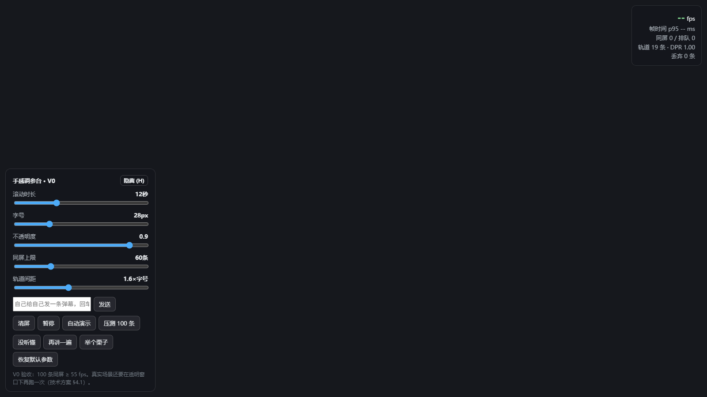

# 课堂弹幕 · 产品技术方案

> **本文档回答「怎么造」。** [产品设计文档](产品设计文档.md) 回答「为什么这么做、做成什么样」，本文档只处理实现路径：架构、选型、算法、数据结构、目录、打包、测试与排期。
>
> 凡是与产品文档冲突的地方，**以产品文档的决策为准**，本文档负责改。

| 项 | 值 |
|---|---|
| 版本 | v0.1（草案） |
| 状态 | 🟡 待评审。架构与选型可执行，但 V-1 现场实测结论尚未回填 |
| 前置文档 | [产品设计文档](产品设计文档.md) |
| 上游阻塞 | 产品文档 Q-010（学生能否连上教室电脑）、Q-013（是否加公网中继） |

---

## 1. 技术目标与约束

### 1.1 不可协商的硬约束

这四条来自真实教室环境（产品文档第 10 章），**任何技术方案违反其一即作废**：

| 约束 | 技术后果 |
|---|---|
| 投影是**整屏镜像** | 投影窗口与老师端必须走两条独立数据流，服务端按角色分流，身份信息永不进入投影流 |
| 老师**不带电脑**，用教室公用电脑 | 交付物必须是**单个免安装程序**，不能要求预装 Node、不能走安装向导 |
| 教室电脑是**公用机器**，无管理员权限 | 不写 C 盘、不写注册表、不留后台服务；首次运行防火墙授权框可能点不动，需有降级路径 |
| 教室外网**每次上课要手动登录**，不可依赖 | 所有前端资源、词库、二维码生成必须本地内置；任何 CDN 引用都是白屏风险 |

### 1.2 技术指标

| 指标 | 目标 | 验证方式 | 阶段 |
|---|---|---|---|
| 弹幕渲染帧率 | ≥ 55 fps @ 同屏 100 条（**透明窗口下**） | 内置帧率计数器 + 性能基准脚本 | V0 |
| 端到端延迟（学生发出 → 投影出现） | < 500 ms（局域网内） | 打时间戳对比 | V1 |
| 老师操作 → 投影生效 | < 1 s | 手工 + 自动断言 | V1 |
| 冷启动（双击 → 弹幕上屏） | < 10 s | 秒表，U 盘冷读条件下 | V1 |
| 并发连接 | ≥ 30 台稳定不掉线，目标 100 台 | 多客户端模拟压测 | V1 |
| 单节课弹幕量 | ≤ 500 条 | 内存与落盘容量核算 | V1 |
| 退出残留 | 0 个注册表项、0 个后台进程、0 个 C 盘文件 | 快照对比脚本 | V1 |
| 投影不含身份信息 | 安全红线，100% | 协议层断言（见 §4.4） | V1 |

### 1.3 技术非目标

明确不做，避免范围蔓延：

- **不做账号体系**：没有注册、没有登录、没有密码。身份只在单节课内有效
- **不做云端**：默认形态下没有任何服务端持久化、没有云数据库、没有 CDN
- **不做 App**：学生端是网页，不发布 iOS/Android 包
- **不做多课程管理**：一次运行 = 一节课。没有历史课程列表、没有课表
- **不做实时音视频**：不引入 WebRTC
- **不做跨平台**：只保证 Windows 10/11 x64。教室里只有这一种

---

## 2. 总体架构

### 2.1 进程模型

**一个 Electron 程序，两个进程，三种角色页面。**

```
┌─ 主进程 (Node.js) ──────────────────────────────┐
│  · HTTP 服务 (:3000)  → 托管 /host /m /screen   │
│  · WebSocket 服务     → 房间、广播、分流         │
│  · 业务中间件         → 限流 / 过滤 / 聚合       │
│  · 会话存储           → 内存态 + 定时落盘        │
│  · 系统能力           → 网卡探测 / 二维码 / 导出 │
│  · 创建并持有弹幕层窗口                          │
└─────────────────────────────────────────────────┘
        │ IPC (contextBridge)          │ ws://
        ▼                              ▼
┌─ 渲染进程：弹幕层 ─┐        ┌─ 浏览器端（手机/大屏）─┐
│  · Canvas 引擎     │        │  /host  老师控制台     │
│  · 只收「投影流」  │        │  /m     学生端         │
│  · 无 Node 权限    │        │  /screen 降级弹幕墙    │
└────────────────────┘        └────────────────────────┘
```

**关键点**：弹幕层窗口虽然跑在 Electron 里，但**它不直接读内存里的业务状态**。它和手机端一样是 WebSocket 客户端，连的是本机的 `ws://127.0.0.1:3000`。这样做有三个好处：

1. 视图流隔离在**协议层**强制生效，绕不过去（见 §4.4）
2. 弹幕层与 `/screen` 网页版可以共用同一套渲染代码 —— U 盘程序跑不起来时，`/screen` 直接接管
3. 调试时可以直接把弹幕层换成浏览器窗口，不用改业务代码

### 2.2 架构图

```
        U 盘（老师随身携带）
   ┌──────────────────────────────────────────┐
   │  单一免安装程序 classroom-danmaku.exe     │
   │   ├ 主进程                                 │
   │   │   ├ HTTP :3000  静态托管 + REST(少量)  │
   │   │   ├ WebSocket   房间 / 广播 / 角色分流  │
   │   │   ├ 限流器      设备级令牌桶 + 滑动窗   │
   │   │   ├ 过滤器      本地内置词库            │
   │   │   ├ 聚合器      语义键 + 时间窗         │
   │   │   ├ netinfo     网卡枚举与优选          │
   │   │   ├ qrcode      本地生成（零依赖）      │
   │   │   └ store       内存态 + 定时落盘       │
   │   ├ 渲染进程：弹幕层（透明·置顶·鼠标穿透）  │
   │   └ 存储：./data/sessions/*.json           │
   └──────────────────────────────────────────┘
                    ↓ 插进教室电脑，双击
   ┌──────────────────────────────────────────┐
   │ 教室电脑（局域网内；外网需手动登录）       │
   │   ├ 弹幕层窗口 ──→ 投影（全班可见）        │
   │   └ 服务端 127.0.0.1:3000 / 0.0.0.0:3000   │
   └──────────────────────────────────────────┘
                    │ http://192.168.x.x:3000
          ┌─────────┴─────────┐
     老师手机 /host        学生手机 /m ×N
     （控制台·私有）       （发弹幕）
```

### 2.3 四条数据流

| 编号 | 路径 | 说明 |
|---|---|---|
| F1 | 学生 `/m` → 主进程 → 弹幕层 + 全部 `/m` | 发弹幕。经限流 → 过滤 → 广播 |
| F2 | 老师 `/host` → 主进程 → 弹幕层 + 全部端 | 控制指令（清屏/暂停/删除/置顶），**必须优先级最高** |
| F3 | 主进程 → 仅 `/host` | 私有数据：身份信息、问题池、待回应计数、`host:alert` 震动 |
| F4 | 主进程 → 重连端 | **全量状态同步**，不是增量。重连后必须能自愈 |

F2 与 F3 是本架构的**隔离面**：F2 广播给所有人（控制状态本来就该公开），F3 只发给老师。

### 2.4 为什么是 Electron（选型决策记录）

| 备选 | 为什么不用 |
|---|---|
| 教室电脑预装 Node + 浏览器 | 公用机器不允许装东西；而且要求老师记住「先开服务再开浏览器」两个动作 |
| 纯浏览器 + 服务器托管公网 | 浏览器浮层盖不住 PPT 全屏放映（产品文档 2.4）；且外网不可依赖 |
| Tauri | 体积小得多（~10MB vs ~150MB），但生态与透明窗口的 Windows 行为资料少，出问题时无处查。**项目只有一个人做，可查性 > 体积** |
| NW.js | 与 Electron 同源但社区小；透明窗口文档更少 |
| 裸 Node + 自绘窗口（C++/C#） | 工作量翻倍，且放弃 Web 技术栈的渲染生态 |

**结论：Electron。** 它同时解决两件本来无关的事 —— 「透明置顶窗口」和「本地 HTTP/WebSocket 服务」，而这正是本项目的核心矛盾（产品文档 2.4）。代价是约 150MB 体积与冷启动开销，放 U 盘可接受。

---

## 3. 技术选型与否决记录

| 层面 | 选择 | 备选 | 否决理由 |
|---|---|---|---|
| 运行时 | Electron 内含 Node.js | 系统 Node / Deno | 不能要求教室电脑预装 |
| 分发 | electron-builder **portable** 单文件 | 安装包 / 手工打包 | 无管理员权限，不能走安装流程 |
| 前端框架 | **无**，原生 JS + 原生 DOM | Vue / React | 三个页面总共不到 800 行 UI 逻辑，框架的构建链反而增加「本地资源必须内置」的维护成本 |
| 构建工具 | **无**（V0–V2） | Vite / esbuild | 同上。若 V3 复杂度上来，再评估 |
| 通信 | `socket.io` | 裸 `ws` | 手机切后台/信号抖动是常态，自带重连、心跳、房间、降级轮询 |
| 弹幕渲染 | **Canvas 2D 单画布** | DOM / WebGL | DOM 100+ 元素必掉帧；WebGL 对纯文字是杀鸡用牛刀，且透明窗口下 GPU 上下文更脆 |
| 存储 | 内存态 + 定时 JSON 落盘 | SQLite | 单节课 ≤500 条 ≈ 50KB，SQLite 是负担。且要保证「拔盘即走」 |
| 二维码 | 本地生成（自带实现或纯 JS 库，代码内置） | 在线二维码 API | 外网不可依赖 |
| 日志 | 本地文件 + 内存环形缓冲 | 上报服务 | 无云端，且要保证不写 C 盘 |
| 测试 | `node:test` + 现有 [check-docs.mjs](../scripts/check-docs.mjs) | Jest / Vitest | 零依赖原则，Node 24 自带够用 |
| HTTPS | **不做** | 自签证书 | 内网 IP + 纯 HTTP；自签证书会让手机浏览器报警告，学生不敢点「继续访问」 |

> **`socket.io` 的取舍说明**：它会给客户端带一个约 45KB 的脚本。这个脚本**必须内置进仓库**，不能走 CDN。这是「本地资源全内置」原则的具体代价。

---

## 4. 关键机制的技术实现

### 4.1 透明置顶弹幕层

**目标形态**：一个铺满主显示器、透明、无边框、置顶、鼠标穿透、不抢焦点的窗口，浮在 PowerPoint 放映之上。

核心参数（Electron）：

```js
const win = new BrowserWindow({
  transparent: true,
  frame: false,
  hasShadow: false,
  resizable: false,
  movable: false,
  minimizable: false,
  skipTaskbar: true,
  focusable: false,        // 关键：绝不抢 PPT 的焦点
  fullscreenable: false,
  webPreferences: { preload, contextIsolation: true, nodeIntegration: false }
});

win.setAlwaysOnTop(true, 'screen-saver'); // 最高层级，要压过放映中的 PPT
win.setIgnoreMouseEvents(true, { forward: true });
```

**四个已知的坑**：

| 坑 | 表现 | 应对 |
|---|---|---|
| PPT 走 **DirectX 独占全屏** | 弹幕层被压到 PPT 下面，完全看不见 | 无解，只能降级。**这是 V-1 必须实测的第一件事** |
| 透明窗口在部分 Intel 核显上变**黑底** | 整屏变黑，灾难性 | 检测不到透明合成成功就立即降级（见下） |
| `setIgnoreMouseEvents` 在某些输入法/触控驱动下失效 | 老师点不动 PPT | 兜底：窗口留一个 8px 的可点击「解锁」热区，或改用 `focusable: true` + 手动转发 |
| 多显示器 / 投影是**扩展模式** | 弹幕层铺错屏幕 | 启动时枚举显示器，默认扑「非主显示器」或让老师选 |

**三级降级梯子**（必须在代码里显式实现，且能自动探测、一键切换）：

| 级别 | 形态 | 触发条件 |
|---|---|---|
| **L0 透明浮层** | 目标形态，弹幕飘在 PPT 之上 | 默认尝试 |
| **L1 底部条带** | 屏幕底部 25% 实心弹幕带，上方 75% 留给窗口化 PPT | L0 在黑底/掉帧/穿透失效检测中失败 |
| **L2 `/screen` 网页版** | 用教室电脑浏览器打开 `http://127.0.0.1:3000/screen` 全屏，退化为「全屏弹幕墙 + 手动切课件」 | U 盘程序根本起不来 |

> L0 的**自动探测**做法：窗口创建后画一个纯色矩形并抓取一帧，若拿到的像素与预期不符（说明透明合成失败），3 秒内提示老师并切 L1。宁可自动降级，也不要让老师面对一块黑屏。

#### 4.1.1 实测踩到的两个坑（V1 修正）

**坑一：探测假阳性 —— 窗口自己的黑底骗过了像素比对。**
第一版的探测是「左半透明、右半洋红」两张采样：右边看到洋红 = 窗口浮在上面，左边与探测前一致 = 透明成功。问题出在"一致"的判据上：桌面深色壁纸 rgb(30,32,38) 与窗口黑底 rgb(11,13,18) 每通道只差 19，落在容差 40 以内 → 判成"一致" → 报透明成功。而 `NEAR_BLACK` 当时是 18，30 > 18 → 又判成"背后不是黑"。两个阈值互相打架，结论必然是错的。

修正三条：
1. `NEAR_BLACK` 提到 **56**（必须 ≥ 采样容差），背景"够不够黑"用 `max(r,g,b)` 判；
2. 左半边取 **4 个候选点**，挑**最亮**的那块当参照 —— 深色壁纸上总有一块更亮的区域，拿它对比才有分辨力；
3. **不确定就退 L1**。旧策略是"测不出来照常上 L0"（理由：降级只会让观感变差），这个理由在后果上不对称：猜错成 L0 是一整块黑板让课上不下去，猜错成 L1 只是弹幕在底部 25% 跑。现在只有 `transparent === true && visible === true` 才给 L0，`null` / `error` 一律 L1 并在托盘上标「探测没测出来」。

**坑二：探测页和弹幕页是两份 CSS，只验了前者。**
真正的黑屏事故不是探测失败，而是**探测通过、弹幕页自己糊了一层黑**：`screen.css` 里 `html, body { background: #0b0d12 }` 写成了一条合并规则，而 overlay 模式只让 `body` 透明 —— `body` 的 background 只在 `html` 没有 background 时才往上传播，所以决定画布底色的是 `html`，整块视口照旧是深色。探测用的是另一份内联的探测页，那份写对了，于是完全测不出来。

修正两条：
1. 底色只写在 `html` 上，overlay 模式用 `html.mode-overlay` 同时放开 `html` 与 `body`；`mode-overlay` 这个类也由 `document.body` 改挂到 `document.documentElement` 上（`tests/unit/screen-page.test.mjs` 里加了 CSS 文本断言与类挂载位置断言，锁死这两条）；
2. 增加**装载真页之后的复验**：`verifyOverlayPage()` 在弹幕页真正上屏后再抓一帧，用探测前的参照图核对同一批采样点有没有被糊掉，不成立就退回 L1。

**与之配套的顺序调整**：窗口**先按 L1 建**（底部 25%），探测 → 定级 → 再撑到全屏；升到 L0 之后在**全屏尺寸上再探一次**，只有全屏也成立才留在 L0。理由是探测本身要抓两次屏、等一两秒，窗口若一上来就是全屏，这段时间里合成一旦失败，老师眼前已经是一块黑板了。

**逃生门**：`Ctrl+Alt+D` 隐藏/显示弹幕层、`Ctrl+Alt+Q` 退出（全局快捷键，不依赖窗口焦点 —— 弹幕层永远拿不到焦点）。托盘里也能切级别，手动切 L0 时走同一道复验闸，不成立就自己退回 L1 并把原因写进托盘。

### 4.2 Canvas 弹幕引擎

#### 4.2.1 渲染循环

单 `<canvas>`，单个 `requestAnimationFrame` 循环，**一帧内完成所有绘制**：

```js
function frame(now) {
  const dt = Math.min(now - last, 50) / 1000; // 夹住，防止切回前台时瞬移
  last = now;
  ctx.clearRect(0, 0, W, H);
  drawPinned();                 // 置顶条：固定顶部，不参与滚动
  for (const item of active) {
    item.x -= item.speed * dt;
    drawText(item);
  }
  recycle();                    // 移出屏幕的对象回收到对象池
  fps.sample(now);
  requestAnimationFrame(frame);
}
```

**为什么不用 CSS/DOM**：100 条同时滚动 + 每帧改 `transform` 会触发 100 次合成层更新，透明窗口下开销更大。Canvas 只有一次绘制调用序列，且完全可控。

#### 4.2.2 轨道分配

```
可用高度 H' = 屏幕高 - 置顶条高 - 上下安全边距
行高 h      = 字号 × 1.6
轨道数 N    = floor(H' / h)

新弹幕 b 到达时，按 i = 0..N-1 尝试：
  取轨道 i 上最后一条弹幕 t
  条件 1（入口让开）： t 不存在，或 t.x + t.width ≤ W - GAP
  条件 2（不会追尾）： b 的**左边缘追上 t 的右边缘**时，t 已经离开屏幕
     设 vb、vt 分别为 b、t 的速度
     vb ≤ vt              → 满足（追不上）
     t 离开屏幕还需要       tExit = (t.x + t.width) / vt
     b 追上 t 的尾部需要    tCatch = (W - (t.x + t.width)) / (vb - vt)
     条件 2 成立 ⇔ tExit ≤ tCatch
  两者都满足 → 占用轨道 i，b.y = i × h + 顶部偏移
  全部轨道都不满足 → 进入等待队列，下一帧重试（最多等待 2 秒，超时丢弃并计数）
```

> **实现修正（V0）**：条件 2 最初写成"t 离开屏幕所需时间 < b 追上 t 所需时间"，
> 但没有说清"追上"是哪个边缘追哪个边缘。按**左边缘追左边缘**理解是错的：
> b 的头部在追上 t 的头部之前，早就已经在吃 t 的宽度了 —— 两条弹幕在那之前就重叠了。
> 正确的判据是"b 的左边缘追上 t 的右边缘"，也就是上面写的形式。
> 这一条由 `src/overlay/engine.js` 的 `laneFits()` 实现，并由
> `tests/unit/engine.test.mjs` 用一组会误判的几何参数钉死。
>
> 另外，每条轨道只需要记录**最后一条**（最靠右的）弹幕 t：更早的弹幕都在它左边，
> 而它们在被放进来时已经各自满足过条件 2，所以不可能被后车追尾。轨道内的不重叠
> 由这个归纳不变量维持，`tests/unit/engine.test.mjs` 用 1200 帧的逐帧几何断言验证。

**速度策略 —— 让同屏停留时间恒定**：

```
duration D 固定（默认 12 秒，可调）
v = (W + textWidth) / D
```

长弹幕速度更快，但**从进入到离开的总时长一致**，视觉上更整齐，也天然降低追尾概率。

**手感参数**（全部做成老师端滑块，实时下发，不需要刷新）：
滚动时长 `D`、字号、透明度、同屏最大条数、轨道间距。这五个值直接决定产品成败（产品文档 8.1）。

#### 4.2.3 对象池与 GC

弹幕对象高频创建/销毁会触发 GC 抖动，表现为**周期性掉帧**。做法：

- 预分配 200 个弹幕对象，`free` 列表复用
- 文本宽度测量结果按 `(text, font)` 缓存进 `Map`，上限 2000 条，超出后整体清空
- 每帧**不创建新数组**：遍历用 `for` 下标，不用 `forEach`/`map`
- 颜色用预解析的字符串，不用每帧拼字符串

#### 4.2.4 高 DPI

```js
const dpr = window.devicePixelRatio || 1;
canvas.width  = W * dpr;
canvas.height = H * dpr;
ctx.setTransform(dpr, 0, 0, dpr, 0, 0);
```

不处理 DPR 会导致投影上文字发虚（教室投影常见 125%/150% 缩放）。

#### 4.2.5 性能预算（每帧 16.7ms）

| 环节 | 预算 | 备注 |
|---|---|---|
| 文字绘制 100 条 | ≤ 8 ms | 最大开销项。开启 `ctx.textBaseline = 'top'` 减少对齐计算 |
| 物理更新 100 条 | ≤ 1 ms | 纯算术 |
| 置顶条 | ≤ 2 ms | 条数少 |
| 绘制二维码 | ≤ 1 ms | **预先渲染成离屏 canvas**，不要每帧重绘 |
| 余量 | ≥ 4 ms | 留给透明合成 |

> 若超标：第一刀砍**阴影与描边**（透明窗口下最贵），第二刀砍同屏最大条数。**绝不砍 DPR**。

### 4.3 通信层

#### 4.3.1 事件协议（完整表）

| 方向 | 事件 | 载荷 | 说明 |
|---|---|---|---|
| C→S | `join` | `{ role, classId, identity?, nickname?, deviceId }` | `role ∈ host \| student \| overlay` |
| C→S | `danmaku:send` | `{ text, presetId? }` | 发弹幕；`presetId` 用于聚合 |
| C→S | `danmaku:like` | `{ id }` | 点赞，设备级去重 |
| C→S | `host:clear` | `{}` | 清屏（不删数据，只清视图） |
| C→S | `host:pause` | `{ paused }` | 暂停/继续 |
| C→S | `host:mute` | `{ minutes }` | 静音 N 分钟，到点自动恢复 |
| C→S | `host:remove` | `{ id }` | 删除单条 |
| C→S | `host:pin` | `{ id, pinned }` | 置顶/取消 |
| C→S | `host:ban` | `{ deviceId }` | 拉黑设备 |
| C→S | `host:fetchIdentity` | `{ id }` | 按需查询真实身份（**仅 host 角色可用**） |
| C→S | `host:resolved` | `{ id }` | 标记为「已回应」，移出问题池 |
| C→S | `host:config` | `{ duration?, fontSize?, alpha?, maxDensity? }` | 手感参数实时下发 |
| C→S | `host:export` | `{}` | 导出本课数据到 U 盘 |
| S→C | `joined` | `{ deviceId, serverTime, config, online }` | 加入成功 |
| S→C | `danmaku:new` | `{ id, text, nickname, color, presetId?, ts }` | 新弹幕 |
| S→C | `danmaku:update` | `{ id, likes?, aggregate? }` | 计数变更 |
| S→C | `danmaku:remove` | `{ id, reason }` | `reason ∈ host \| filter` |
| S→C | `danmaku:pin` | `{ id, pinned }` | 置顶状态 |
| S→C | `state` | `{ paused, mutedUntil, clearedAt, online, danmakuCount }` | **全量状态**，重连必发 |
| S→C | `config` | `{ duration, fontSize, alpha, maxDensity }` | 手感参数 |
| S→C | `rateLimited` | `{ retryAfterMs, message }` | 友好提示，不是错误 |
| S→C | `rejected` | `{ tempId, reason }` | 撤销本地先回显 |
| S→C | `host:alert` | `{ id, reason, aggregate }` | **仅发 host**：进问题池，触发震动 |
| S→C | `host:identity` | `{ id, studentId, name }` | **仅发 host** |
| S→C | `error` | `{ code, message }` | 协议级错误 |

**约定**：
- 所有时间戳为服务端毫秒时间（`serverTime`），客户端用 `joined` 里的偏移量校准，避免学生手机时钟不准导致弹幕排序错乱
- 客户端本地先回显用 `tempId`，服务端确认后回 `danmaku:new` 带真实 `id`，失败回 `rejected { tempId }`

#### 4.3.2 连接生命周期与重连

| 阶段 | 行为 |
|---|---|
| 首次连接 | 带 `deviceId`（localStorage 里的 UUID，服务端下发的）发起 `join` |
| 断线 | `socket.io` 自动重连，指数退避（1s → 2s → 4s → 上限 10s） |
| 重连成功 | 服务端**必发 `state` + `config`**，客户端**清空本地弹幕队列后重建** |
| 切后台（手机锁屏） | 浏览器可能冻结定时器。重连后靠 `state` 自愈，不依赖增量 |
| 长时间离线 | 超过 5 分钟未连上，学生端显示「与课堂断开，正在重连」而不是静默失败 |

> **重连后必须全量同步**是这个协议最重要的约定。增量同步在这里是 bug 温床：老师清屏时学生正好锁屏，回来就会看到一屏幽灵弹幕。

#### 4.3.3 心跳

`socket.io` 自带 ping/pong，心跳间隔调到 **25 秒**（默认更短）。80 台手机 × 25 秒的心跳流量可以忽略，但能显著降低手机电量消耗（产品文档提到「手机电量/流量」是风险项）。

#### 4.3.4 老师操作的优先级

老师指令必须**插队**：

```
所有入站消息进两个队列：
  hostQueue     —— host:* 指令
  normalQueue   —— danmaku:* 学生消息
每轮事件循环先清空 hostQueue，再处理 normalQueue（每轮上限 50 条）
```

否则「老师点清屏」会排在 80 条学生弹幕后面，1 秒内生效的验收标准就保不住。

### 4.4 视图流隔离的实现位置

**隔离在协议层，不在渲染层。** 服务端维护 `role`，广播时按角色分发给**不同的载荷**：

```js
function broadcastDanmaku(item) {
  const publicPayload = { id, text, nickname, color, presetId, ts };   // 无身份
  io.to(ROOM_PUBLIC).emit('danmaku:new', publicPayload);              // overlay + screen + m
  io.to(ROOM_HOST).emit('danmaku:new', {
    ...publicPayload,
    deviceId: item.deviceId                                          // 仅老师可见
  });
}
```

**三条硬规则**：

1. 身份字段（`studentId`、`name`、真实 `deviceId`）**只在 `host` 房间的消息体里出现**，且默认不下发，只有 `host:fetchIdentity` 主动请求时才发
2. `overlay` 与 `screen` 角色**永远不加入 `host` 房间**
3. 有一条自动化测试：抓取发送给 `overlay` 房间的**所有**消息，断言其中不含 `studentId` / `name` / `deviceId` 字段（见 §8.2）

> 第三条是这个红线的唯一可靠保障。靠人工 review 一定会退化。

### 4.5 限流与防刷屏

**双层**：设备级令牌桶（主）+ IP 级滑动窗口（辅，防换设备绕过的初级攻击）。

```js
const RULES = {
  minIntervalMs: 3000,      // 两条之间至少 3 秒
  perMinute: 10,
  perSession: 200,
  strikeMuteMs: 60_000,     // 连续触发 → 静默 60 秒
  strikeThreshold: 3
};
```

- 设备标识：服务端下发的 UUID，存在 `localStorage`。清缓存会换新 ID —— 接受这个成本，因为清除缓存的门槛足够高
- 拉黑名单按 `deviceId` + `IP` 双键
- **限流提示必须友好**：`rateLimited { retryAfterMs }`，前端显示倒计时而不是报错（产品文档 8.4）

### 4.6 聚合计数

```js
// 语义键 = 预置按钮 ID + 时间桶
const key = `${presetId}#${Math.floor(now / WINDOW_MS)}`; // WINDOW_MS = 30000
```

- `Map<key, { id, count, firstTs, lastTs }>`；新点击命中已有 key 则 `count++`
- **广播节流**：计数变化不逐次广播，按 200ms 合并推送一次。否则 31 个人点「没听懂」会产生 31 次广播
- 时间窗过期 → 该条固定，不再增长，并从聚合表销毁
- 屏幕上表现为 `没听懂 ×23`，数字变化时有一个轻微的放大动效（`scale` 在 120ms 内回弹）

> **这个机制强依赖预置按钮**（产品文档 Q-003）。若最终决定只做自由打字，本节退化为「高频文本归一化匹配」，效果显著变差 —— 这是技术方案对产品决策的依赖，已记入第 11 章。

### 4.7 点赞、热点与置顶

- **去重**：`Set<deviceId>` 挂在弹幕对象上。设备级，不做用户级
- **排序与滚动的解耦**（关键）：点赞数**绝不改变弹幕在滚动流中的位置**，只影响：
  1. **问题池**排序（老师手机端）
  2. **热点条**：点赞数跨过阈值时，弹幕层顶部出现一条不滚动的提示，显示 `👍12 能举个例子吗`
- **置顶**：老师手动置顶的条目进入顶部固定区，最多 3 条，超出时按置顶时间淘汰最旧一条

### 4.8 内容安全

三层，按实际有效性排序（产品文档 8.5）：

| 层 | 实现 |
|---|---|
| 1. 限流 | §4.5，最有效 |
| 2. 屏蔽词 | 本地内置词库，进内存构建 `Aho-Corasick` 自动机做多模式匹配（或词量小的话直接 `includes` 循环） |
| 3. 老师撤回 | 兜底，真正起决定作用的是老师的手速 |

**词库变体处理**：做**归一化**而不是穷举变体 —— 去掉空白、标点、零宽字符，全角转半角，常见谐音映射表。然后匹配归一化后的串，命中后仍然拦截**原文**。

**词库形态**：一个内置 JSON 数组，构建时打包进程序。**不允许运行时下载**（外网不可依赖）。

### 4.9 身份与追溯

| 环节 | 做法 |
|---|---|
| 采集 | 首次进入填**学号 + 姓名**（产品文档 8.6）。学号做格式校验，姓名长度限制 |
| 学生侧可见 | 只有自取昵称或「匿名同学」 |
| 存储 | 内存态持有；落盘时写入同一份 JSON。**不加密** —— 理由是导出文件本来就要给老师看，加密只会制造「数据被保护了」的错觉 |
| 老师侧查看 | 默认**不下发**，必须 `host:fetchIdentity` 主动拉取。这条设计让「老师随手翻身份」有物理成本 |
| 保留期 | 默认随课程结束。退出程序时提示「导出后即清除内存」，落盘文件由老师自行保管 |
| 拉黑 | 老师端一键，按 `deviceId` + `IP` |

### 4.10 地址发现与二维码

**这是最容易翻车的一步**：教室电脑上往往装了 VMware / VirtualBox / Hyper-V / WSL，`os.networkInterfaces()` 会返回一堆虚拟网卡地址，随便挑一个生成二维码 → 全班扫了打不开。

```js
// 优先级打分，从高到低
// 0. 电脑移动热点（192.168.137.1，或网卡名形如「本地连接* N」）        → 120 分
// 1. 物理网卡（非虚拟） + 192.168.x.x / 10.x.x.x / 172.16-31.x.x     → 100 分
// 2. 物理网卡 + 其他 IPv4                                               → 60 分
// 3. 虚拟网卡（名字含 VMware/VirtualBox/Hyper-V/WSL/vEthernet）          → 0 分，直接排除
// 4. 169.254.x.x（APIPA，说明没拿到 DHCP）                              → 排除并报警
```

**热点为什么排在物理网卡前面**（V1 实测补的）：那张虚拟网卡**只可能是老师主动打开热点才存在的** —— 没有第二种理由，而热点存在的全部意义就是"让别的设备连上我"。反过来把以太网排前面，老师屏幕上就会出现一个学生路由不到的地址，而二维码看起来完全正常。

真机上踩到的具体顺序：教室电脑同时有 `以太网 10.109.12.63` 和 `本地连接* 10 192.168.137.1`（热点已开），两者都是私有地址、都是 100 分，于是按码位比网卡名 —— `以`(U+4EE5) < `本`(U+672C)，**以太网赢**，二维码指向了学生连不上的那个。修法就是给热点 120 分。

两个约束：
- 按地址识别必须**精确到 `192.168.137.1`**，不能放宽到 `192.168.137.0/24` —— 家用路由器完全可能随手发 `192.168.137.x` 给一张普通无线网卡，那种网卡不该被抬优先级
- 热点地址本身是私有地址，`scope` 仍然是 `lan`，界面靠单独的 `hotspot` 字段把它显示成「电脑热点」。既不能让 `describeChoice` 去报"不是局域网地址"，也不能把「本地连接* 10」这种名字原样甩给老师

**并且必须给老师一个「换一个地址」的按钮**：程序在弹幕层右下角显示当前二维码，老师手机上也能看到候选地址列表并手动切换。自动探测再聪明也会错，留一个手动出口成本极低。

二维码**预先渲染成离屏 canvas**，每帧只 `drawImage`（见 §4.2.5 性能预算）。

#### 4.10.1 实测踩到的两个坑（V1 修正）

老师现场报「**这个二维码完全不能用**」，查下来二维码本身一个模块都没错 —— 是它背后那个地址到不了。这两个坑都不是代码写错，是"局域网"这三个字背后的前提没被说出来。

**坑一：学生手机在移动数据上。**
二维码里装的是 `10.x` / `192.168.x` 内网地址，只有和这台电脑在同一个局域网里的手机才路由得到。用手机流量时，码解得再准也只会转圈打不开；而学生（和老师）的第一反应都是"这程序有问题"。

服务端**无从知道**学生的手机连在哪个网上，所以这件事只能无条件说出来，不能靠检测。修法：

- 投影页和老师端的卡片上常驻一句「学生手机要连和这台电脑同一个 Wi-Fi（手机流量打不开这个地址）」，用强调色，不给它 `hidden` 的机会
- 一个地址都没查到时**也要写这句**：那时候学生更得知道是"网不一样"，而不是"我手机坏了"

**坑二：便携版每次启动都解压到一个新的随机临时目录。**
electron-builder 的 `portable` 目标默认解压到 `%TEMP%\<随机名>\`，而 **Windows 防火墙是按程序完整路径放行的** —— 老师第一次运行时点了「允许访问」，那条规则指向的是那一次的随机目录；下一次启动路径就变了，规则等于不存在。机器上能查到一串指向早已删掉的临时目录的死规则，就是这么攒出来的。

修法（根治 + 兜底，四层）：

1. `build.portable.unpackDirName = "课堂弹幕"` —— 便携版**固定**解压到 `%TEMP%\课堂弹幕\`，程序路径从此稳定，放行一次长期有效（实测确认两次启动的路径完全一致）
2. 启动时自检当前 `process.execPath` 有没有被防火墙放行，**只读、不弹窗**，结论进托盘
3. 托盘的「放行防火墙」一键提权加规则（`localport=any` + `profile=any`，按程序放行，不钉端口 —— 端口会递增，见 §7.4）
4. 没放行时把原因和办法塞进 `/api/info` 的 `warnings`，老师端卡片上直接能看到

判定必须是**三态**，不能只有"行/不行"：查不出来（`unknown`）一律**不报警** —— 在一个本来就没问题的机器上天天喊"学生连不上"，比漏报更快让人不再相信这句话。

### 4.11 落盘与导出

- 定时落盘：每 30 秒 + 每次关键操作后（清屏/删除/导出），写 `./data/sessions/<YYYY-MM-DD-HHmm>.json`
- 原子写：先写 `.tmp` 再 `rename`，避免拔盘瞬间产生半截文件
- **相对路径，基准是 exe 所在目录**（即 U 盘），绝不写 `app.getPath('userData')`（那会落到 C 盘）
- 导出产物两种：
  - `.json` —— 完整原始数据，用于二次分析
  - `.md` —— 人可读摘要：时间、总条数、在线人数、高频问题 Top 20、被置顶/被回应的问题及学生原话

### 4.12 公网通道：内置花生壳内网穿透

产品文档 10.5 原本设想的是「教室电脑只当客户端，服务搬到公网服务器」。**落地时改成了另一条路**：服务端仍在教室电脑上，用**内网穿透**把本机端口暴露到一个公网地址。这样 §4.3–§4.11 的房间、广播、限流、落盘一行都不用改 —— 它解决的是 §4.10 的前提问题（学生手机和教室电脑在不在同一个网里），不是服务放哪儿的问题。

**为什么需要它。** §4.10 那两个前提在两种情况下不成立：学生手机在移动数据上、教室 Wi-Fi 开了 AP 隔离。这两种情况下内网地址**再准也路由不到**，而服务端无从检测（学生连在哪个网上，服务端看不见）。

**实测数据**（`%TEMP%\tuntest\ws4.mjs`，10 样本，遵守 §4.5 限流）：

| 链路 | 结果 |
| --- | --- |
| 弹幕全链路往返（经公网） | p50 **48ms** / p95 **84ms** / max 84ms，10/10 成功、0 限流 |
| WebSocket 握手 / join 回执 | 37ms / 72ms |
| HTTP `/api/info`（含 TLS 首连）/ `/m/` / `/shared/protocol.js` | 270ms / 90ms / 37ms |
| TCP 到国内中转（hz） | 22ms（对照海外 `localhost.run` 323ms） |

海外免费穿透的 p95 是 1.9–4.0 秒，比它快 20–50 倍。**中转必须选国内的**，这是这条通道能用的前提。

#### 4.12.1 二进制契约（这是集成的地基，都实测过）

内置的是花生壳官方 Go 二进制 `hsk-cli-windows-amd64-v0.7.26.exe`（8.5MB，放 `vendor/hsk/`，打包后落在 `resources/hsk/`）。

```
hsk.exe --format json tunnel -ip 127.0.0.1 -port <port>
```

- `--format json` 是**全局旗标**，放子命令前后都行；结果在 **stdout 打单行 JSON**，`data.public_url` 就是公网地址（非 JSON 格式下是 `[AI_RESULT] public_url:` 这些行）
- **进程必须一直活着**：打印地址之后它不退出，退出码只在被杀时出现 —— 隧道是前台进程，**没有 `stop` 子命令，停它只能杀进程**
- `[AI_INFO]` 一类日志走 **stderr**，所以解析要分别收两个流，不能混在一个缓冲里
- Go 二进制**自己不写资源表**（只有 npm wrapper 写），所以**生命周期完全由本程序负责**
- `auth status --format json` → `{"authenticated":true,"account_id":"…","expires_at":"…"}`，用来判断老师有没有绑定过账号

#### 4.12.2 三个必须绕开的坑

1. **`auth login` 会冲掉已有的有效 token。** 它一启动就把 `~/.hsk/auth.json` 改写成 `status:"pending_callback"`，哪怕这次登录最后没走完，原来那份 token 也回不来了。→ 调它之前先备份 `auth.json`，**没拿到 `authorize_url` 就立刻还原**（拿到了说明流程真在跑，保留）。
2. **`HOME` 为空时 hsk-cli 把资源表写进当前工作目录。** 实测在 pwsh 里 `$env:HOME` 是空的，`.hsk/resources.json` 就落在了项目根目录（里面含账号的 publicUrl 和 pid）。→ `spawn` 时必须显式覆盖 `HOME` 与 `USERPROFILE`（两个都要：Go 在 Windows 上读后者），并且把 `.hsk/` 加进 `.gitignore` 兜底。
3. **Windows 父进程退出不带走子进程。** 桌面程序崩了、或者老师直接关机，隧道进程会留在后台继续占着那条映射。→ 用 `taskkill /pid <pid> /T /F` 杀整棵树，并在 `close()` 里先 `await tunnel.stop()`。

#### 4.12.3 接口与状态机

路径定义在 `src/shared/tunnel-api.js` 一份里，**服务端和老师端页面 import 同一个文件**（页面走 `/shared/` 挂载点，没有构建步骤，写两遍迟早一边改了另一边没改）。

| 接口 | 动词 | 作用 |
| --- | --- | --- |
| `/api/tunnel/status` | GET | 查状态；带 `?account=1` 时顺带问一次账号绑定情况 |
| `/api/tunnel/start` | **POST** | 开公网 |
| `/api/tunnel/stop` | **POST** | 关公网 |
| `/api/tunnel/login` | **POST** | 起一次账号绑定，返回授权链接 |

两个硬约束：

- **改状态的接口一律只收 POST。** GET 能被学生页用一个 `` 触发 —— 学生把老师的公网关掉，这是能被恶意利用的。
- **同源闸门。** `Sec-Fetch-Site` 必须是 `same-origin`/`none`；带了 `Origin`/`Referer` 时 host 必须等于 `Host`；三者都没有（curl、测试）才放行。跨站一律 403。理由同上。

状态机 `off → starting → on → off`，出错进 `error`，没绑定账号进 `no_account`；页面把 `no_account` 显示成「需要先绑定账号」，点一次就走绑定流程。

**`start()` 不等公网地址就返回**，页面轮询 `/api/info` 自己看它变成 `on`。实测建一次隧道约 16 秒，等满可能 45 秒 —— 让 HTTP 请求挂在那儿，老师刷新页面就只能看到一直转圈。

#### 4.12.4 对其它章节的影响

- §4.10 的候选地址列表**公网地址排在最前**（`best` 就是它），老师端的二维码跟着自动重画
- 文案必须跟着切：挂公网时说「手机用流量也能连」，不能再挂「学生手机要连和这台电脑同一个 Wi-Fi」—— 那两句恰好是这个功能要解决的问题，留着等于劝老师把刚开的功能关掉
- **公网地址每次启动都不一样**（免费版），所以二维码只能动态生成，不能印死；一节课结束或退出程序时必须断开，否则那条映射一直占着
- 免费版一次只能有一条隧道，且依赖老师有花生壳账号 —— 这是这条通道的代价，产品上必须说清楚（《产品设计文档》10.5）

---

## 5. 数据模型

### 5.1 内存态

```js
{
  session: {
    classId, startedAt, endedAt,
    config: { duration, fontSize, alpha, maxDensity },
    state: { paused, mutedUntil, clearedAt }
  },
  devices: Map<deviceId, {
    deviceId, role, nickname, studentId?, name?,
    joinedAt, lastSeenAt, ip, uaHash,
    strikes, banned, msgCount, lastMsgAt
  }>,
  danmaku: [{
    id, seq, deviceId, text, nickname, color, presetId?,
    ts, likes: number, likedBy: Set<deviceId>,
    pinned, removed, removedReason?, aggregate?
  }],
  aggregates: Map<`${presetId}#${bucket}`, { id, count, firstTs, lastTs }>,
  issues: [{ id, count, likes, pinned, resolved, lastAt }]   // 问题池
}
```

### 5.2 落盘 schema

```json
{
  "schema": 1,
  "classId": "2026-03-14-0830-a7f3",
  "startedAt": 1773448200000,
  "endedAt": 1773453600000,
  "config": { "duration": 12, "fontSize": 28, "alpha": 0.9, "maxDensity": 60 },
  "stats": { "online": 78, "total": 213, "removed": 4, "rateLimited": 17 },
  "presets": [{ "id": "not_understood", "label": "没听懂" }],
  "danmaku": [
    { "seq": 1, "text": "这里没听懂", "presetId": "not_understood",
      "nickname": "匿名同学", "ts": 1773448500000, "likes": 12,
      "studentId": "2023xxxx", "name": "张三", "removed": false }
  ]
}
```

> **`schema` 字段从第一版就写。** 单节课数据是长期资产（产品文档 V4），将来必然要改结构，没有版本号就只能靠猜。

### 5.3 容量核算

- 单条约 120 字节（含身份）→ 500 条 ≈ 60KB，加元信息 < 100KB
- 一学期 40 次课 ≈ 4MB。**U 盘随便放**
- 内存：500 条对象 + 100 个设备 ≈ 数百 KB

**结论：单节课的量级小到不需要任何数据库。**

---

## 6. 目录结构

```
课堂弹幕/
├── AGENTS.md
├── package.json
├── docs/
│   ├── 产品设计文档.md
│   └── 产品技术方案.md
├── scripts/
│   └── check-docs.mjs            # 文档校验（已存在）
├── src/
│   ├── main/                     # Electron 主进程
│   │   ├── index.js              # 入口：装配服务 + 创建弹幕层窗口
│   │   ├── overlay.js            # 透明置顶窗口 + 三级降级
│   │   ├── netinfo.js            # 网卡枚举与优选
│   │   ├── qrcode.js             # 本地二维码
│   │   ├── store.js              # 内存态 + 原子落盘 + 导出
│   │   └── server/
│   │       ├── http.js           # 静态托管 + 少量 REST
│   │       ├── ws.js             # socket.io 装配、房间、分流广播
│   │       ├── dispatch.js       # 双队列与优先级（§4.3.4）
│   │       ├── ratelimit.js      # 令牌桶 + 滑动窗口
│   │       ├── filter.js         # 归一化 + 屏蔽词
│   │       └── aggregate.js      # 语义键聚合 + 广播节流
│   ├── shared/
│   │   ├── protocol.js           # 事件名与常量，主进程与前端共用
│   │   └── config.js             # 默认手感参数、阈值
│   ├── overlay/                  # 弹幕层渲染进程
│   │   ├── index.html
│   │   ├── engine.js             # Canvas 引擎（轨道/对象池/DPR）
│   │   └── overlay.css
│   └── web/                      # 三个网页端（原生 JS，无构建）
│       ├── host/                 # /host
│       ├── m/                    # /m
│       ├── screen/               # /screen（复用 overlay/engine.js）
│       └── assets/               # 含 socket.io 客户端脚本，全部内置
├── tests/
│   ├── unit/                     # node:test
│   └── simulate/                 # 多客户端压测脚本
└── data/                         # 运行期落盘（.gitignore）
```

---

## 7. 构建、打包与 U 盘布局

### 7.1 开发环境

- Node 24（当前机器：Node v24.9.0 / npm 10.9.2 / pnpm 10.34.5）
- `npm test` → `node scripts/check-docs.mjs`（当前）；V0 起扩展为 **`check-docs && node --test tests/`**
- **无构建步骤**：前端是原生 JS，直接被 `http.js` 静态托管；改完刷新即可

### 7.2 打包

- `electron-builder` 同时出两个 Windows 目标：
  - **`portable`** —— 单个 `.exe`（`课堂弹幕-<版本>.exe`），插 U 盘、发给别人即用
  - **`zip`** —— 解压即用目录（`课堂弹幕-<版本>-win.zip`），解压一次后直接双击目录里的 `课堂弹幕.exe`
- `--publish never`（不上传）
- `build.electronDist` 指向已解包的 `node_modules/electron/dist`，**打包全程不联网**
- `build.electronLanguages` 只留 `zh-CN` / `en-US`：解包体积 368.1MB → 320.9MB，单文件 95.5MB → 88.0MB
- **U 盘格式必须排除 FAT32**：单文件 > 4GB 才会出问题，本项目不会，但 FAT32 的写入速度会让落盘变慢。推荐 exFAT

**为什么是两个目标（2026-10-12 本机实测，NVMe SSD）**

| 形态 | 冷启动到 `/api/info` 可服务 | 说明 |
|---|---|---|
| `portable` 单文件 `.exe` | **6.6–13.8s（波动大）** | 每次启动都要把 320MB 自解压到 `%TEMP%`，多次测量在 6.6 / 6.9 / 12.6 / 13.2 / 13.8 之间跳 |
| 解压目录里的 `课堂弹幕.exe` | **0.74–1.14s（稳定）** | 直接从磁盘启动，没有解压这一步 |

- 把 `build.compression` 调成 `store`、把语言包从 47MB 砍到 0，portable 的耗时**都没有变化**；
  而同样 320MB 的目录裸拷贝只要 0.2s —— 瓶颈不在磁盘 I/O，而在**自解压 + 杀软对新写出的 exe 的实时扫描**。
- 解压目录第二次启动会更快（1.06s → 0.74s），portable 不会：它每次都解压到一个新的随机临时目录。
- 结论：**§7.4 的「冷启动 < 10s」只有解压形态能稳定满足**，所以交付双轨 —— 解压目录为主，单文件为辅。
- 上面两个数字都是**本机 SSD** 的结果；换上 U 盘冷读只会更慢，因此解压形态是唯一稳妥的默认。

### 7.3 U 盘布局

```
U盘根目录/
└── 课堂弹幕/
    ├── 课堂弹幕.exe              # 解压即用形态，日常双击这个
    ├── (其余解压出来的文件)       # dll / locales / resources —— 不能只拷 exe
    ├── data/sessions/            # 落盘目录（自动创建）
    └── 说明.txt                   # 一页纸：双击 → 扫码 → 上课
```

- 只想要**一个文件**时用 portable 的 `课堂弹幕-<版本>.exe`，代价是每次启动多等约 12 秒。
- 两种形态的 `data/` 都落在 **exe 所在目录**（单文件形态取自 `PORTABLE_EXECUTABLE_DIR`），不写 `app.getPath("userData")`。

### 7.4 启动与退出

| 环节 | 要求 |
|---|---|
| 启动 | 双击到弹幕上屏 **< 10 秒**。解压形态实测 0.7–1.1s 达标；portable 单文件因每次自解压需约 13s（见 §7.2）。启动期间显示一个小的启动画面（不能是白屏，老师会以为死机） |
| 首次运行 | Windows 防火墙授权框 → 弹窗引导老师点「允许访问」。**若点不动（无管理员权限），立即提示降级路径** |
| 端口占用 | 3000 被占则自动递增到 3001、3002…，并把最终端口写进二维码 |
| 退出 | 停服务、落盘、清理窗口。**不写注册表、不装服务、不留后台进程** |
| 崩溃 | 写入崩溃日志到 U 盘，下次启动时提示「上次异常退出」 |

---

## 8. 测试与验证策略

### 8.1 分层

| 层 | 工具 | 覆盖 |
|---|---|---|
| 文档 | [check-docs.mjs](../scripts/check-docs.mjs) | UTF-8、围栏闭合、链接可达、H1 唯一；**本次新增章节引用校验** |
| 单元 | `node:test` | 限流、过滤、聚合、轨道分配、网卡优选 |
| 协议 | `node:test` + 假 socket | 分流广播、重连全量同步、优先级队列 |
| 集成 | 真实服务 + N 个 headless 客户端 | 并发、延迟、内存增长 |
| 现场 | 手工清单 | 产品文档第 14 章的 V-1 清单 |

### 8.2 必须存在的自动化测试

| 测试 | 断言 |
|---|---|
| **投影流不含身份**（安全红线） | 抓取发给 `overlay` / `screen` 房间的全部消息，断言不含 `studentId`、`name`、`deviceId` |
| 限流 | 3 秒内第二次发送被拦；1 分钟第 11 条被拦；连续 3 次触发静默 60 秒 |
| 聚合 | 时间窗内同 `presetId` 合并计数；窗过期后不再增长；广播次数 ≤ 实际点击次数 / 3 |
| 重连自愈 | 客户端断线期间老师清屏 → 重连后客户端状态与 `state` 一致，无幽灵弹幕 |
| 轨道分配 | 同屏 100 条时无重叠；等待队列超时正确丢弃并计数 |
| 网卡优选 | 给定含 VMware/Hyper-V/APIPA 的网卡列表，选出正确的局域网地址 |
| 文档 | 现有 `check-docs.mjs` 全部通过 |

### 8.3 多客户端模拟压测

`tests/simulate/` 下一个脚本，开 N 个 WebSocket 客户端模拟学生：

- 可配 N（默认 100）、发送频率、持续时间
- 输出：连接成功率、消息端到端延迟分布（p50/p95/p99）、服务端内存增长、丢消息数
- 这是**唯一能在没有 80 个学生的情况下验证并发能力**的手段

### 8.4 现场验证（与产品文档第 14 章对齐）

程序里内置一个 **`/diag` 自检页**，老师在教室打开就能看到：

- 本机所有网卡与优选地址
- 监听端口是否可达（自测一次本机 HTTP 请求）
- 透明窗口是否在置顶（自测像素抓取结果）
- 当前帧率
- 已连接设备数

**把这个页面给老师，等于把「教室网络能不能通」变成本人 30 秒可自答的问题。**

### 8.5 性能基准

`tests/bench/` 下用 headless 浏览器跑 Canvas 引擎：注入 100/300/500 条弹幕，采样 10 秒，输出平均帧率与 p95 帧时间。**在透明窗口与非透明窗口下各跑一次** —— 两者的差距就是 §4.1 那个坑的量化值。

---

## 9. 里程碑与任务分解

| 阶段 | 技术任务 | 交付物 | 验收 |
|---|---|---|---|
| **V-1**（不写代码） | 带笔记本去教室实测。程序形态未定，可用一个最小 Electron 透明窗口 demo 代替 | 实测结论回填产品文档 | 产品文档第 14 章清单全部有答案 |
| **V0** | 单机原型：一个本地页面自己给自己发弹幕；Canvas 引擎 + 五个手感滑块 | 手感调参页 | ≥55 fps @ 100 条（透明窗口下） |
| **V1** | 服务端（http/ws/dispatch/ratelimit）+ `/m` + `/host` 简版 + 弹幕层接入 + 网卡优选 + 二维码 + 打包成 portable exe 与解压即用 zip | 可插 U 盘跑通全链路 | 30 台并发不掉线；端到端 < 500ms；冷启动 < 10s（解压形态，见 §7.2） |
| **V2** | 老师管控：清屏/暂停/静音/删单条/屏蔽词/拉黑 + 双队列优先级 | 老师愿意开第二次 | 手机操作 → 投影生效 < 1s |
| **V3** | 聚合计数 + 点赞 + 热点条 + 问题池 + `host:alert` 震动 + 手感参数实时下发 | 互动闭环 | 学生第 3 次课还发 |
| **V4** | 落盘与导出（json + md）、`/diag` 自检页、崩溃日志 | 课后资产 | 导出文件人可读可用 |

**V0 可以立刻开工**，它不依赖 V-1 的任何结论 —— 这是当前唯一能并行推进的部分。

### 9.1 V0 实施进度

代码已落地，测试全绿（`npm test`：文档校验 + 51 条单元测试）。

| 交付项 | 文件 | 状态 |
|---|---|---|
| 手感参数定义与夹紧 | `src/shared/config.js` | ✅ |
| Canvas 引擎（轨道分配、对象池、恒定停留时长、高 DPI、等待队列） | `src/overlay/engine.js` | ✅ |
| 手感调参页（五个滑块 + 预设按钮 + 压测） | `src/web/screen/{index.html,screen.css,screen.js}` | ✅ |
| 零依赖静态服务 + 端口自动递增 | `src/main/server/http.js` | ✅ |
| URL ↔ 磁盘目录映射 | `src/main/server/routes.js` | ✅ |
| 开发服务器 | `scripts/dev-server.mjs`（`npm run dev`） | ✅ |
| 引擎测试 18 条 | `tests/unit/engine.test.mjs` | ✅ |
| 静态服务测试 20 条 + 页面托管测试 5 条 | `tests/unit/http.test.mjs`、`tests/unit/page-serving.test.mjs` | ✅ |
| 静态资源图测试 7 条 + 编码守卫 2 条 | `tests/unit/static-graph.test.mjs`、`tests/unit/encoding.test.mjs` | ✅ |

**尚未完成的验收**：V0 的验收标准是"透明窗口下 ≥55 fps @ 100 条"。透明窗口属于 V1 的
Electron 工作，因此当前只能在**普通浏览器窗口**里点「压测」按钮看到帧率读数
（页面上会直接显示"达标 / 未达标"）。透明窗口下的真实数字要等 V1 接入后再测一次，
届时以 Chrome DevTools 的 Performance 面板复核。

`npm run dev` 之后打开 `http://127.0.0.1:3000/screen/` 就是交付物本体：



**V0 期间发现并修正的两处方案问题**：

1. **§4.2.2 条件 2 的几何表述有歧义且按字面理解是错的**。已在 §4.2.2 内就地修正为
   "b 的左边缘追上 t 的右边缘"。
2. **页面不能直接挂在 `/screen` 上**。`index.html` 挂在无尾斜杠的路径时，页面能打开、
   控制台不报错，但**白屏** —— 浏览器把页面里的 `./screen.js` 按当前 URL 解析成了
   `/screen.js`。因此新增了 `src/main/server/routes.js`：每个页面目录必须在 URL 上
   表现为真正的目录（`/screen/`、未来的 `/m/`、`/host/`），裸路径一律 302 补尾斜杠。
   `tests/unit/page-serving.test.mjs` 会从页面 URL 出发，把整个 ES module 依赖图
   按浏览器的方式逐个请求一遍，专门防这一类"看起来全对但页面是白的"故障。

---

## 10. 风险与技术债

| 风险 | 影响 | 应对 |
|---|---|---|
| **PPT 独占全屏盖不住** | 路线 B 失效 | V-1 先测；三级降级梯子（§4.1） |
| **透明窗口黑底 / 掉帧** | 投影不可用 | 自动像素探测 + 切 L1 底部条带 |
| **教室网络不通** | 全班连不上 | 无技术解，靠 Q-010 实测 + Q-013 公网中继兜底 |
| **Electron 冷启动超 10s** | 老师烦躁 | **已实测并解决**：portable 单文件每次要花约 12s 自解压（§7.2），故改为双轨交付 —— 日常用解压目录（0.74–1.06s），单文件只留给临时借用场景 |
| **无管理员权限放行防火墙** | 学生连不上 | 首次运行引导；不行则切「教室电脑开热点」或 L2 降级 |
| **`socket.io` 客户端脚本必须内置** | 断网白屏 | 打包进 `assets/`，构建脚本断言无外链 |
| **单进程 CPU 打满** | 弹幕卡顿 | Canvas 性能预算；把聚合与过滤保持为 O(1)/O(消息长度) |
| **技术债：无构建工具** | 代码量上来后难维护 | 有意为之。**若 `src/web` 超过约 1500 行再评估引入 Vite** |
| **技术债：身份明文落盘** | 数据泄露风险 | 有意为之（§4.9 已说明理由）。若将来上公网中继，必须重新评估 |

---

## 11. 待定项对技术方案的影响

| 编号 | 待定问题 | 对本文档的影响 |
|---|---|---|
| **Q-010** | 学生手机能否连上教室电脑 | 🔴 **决定 §4.10 是否成立**。不通则整个局域网形态作废，只能走 Q-013 |
| **Q-013** | 是否加公网中继 | 🟡 影响 §4.12。**现在不实现**，但连接地址不能硬编码 |
| **Q-003** | 学生输入方式（自由打字 / 预置按钮） | 🔴 **决定 §4.6 聚合计数是否可用**。只做自由打字 → 聚合退化为文本归一化，效果显著变差 |
| **Q-005** | 身份采集强度 | 🟡 影响 §4.9 的采集表单与落盘字段 |
| **Q-002** | 学生端是否可见弹幕流 | 🟢 影响 `/m` 的 UI，不影响协议（`ROOM_PUBLIC` 本来就包含 `m`） |
| **Q-008 遗留** | 投影是复制还是扩展模式 | 🟡 影响 §4.1 里「弹幕层铺哪块屏」的默认值与选择器 |

---

## 12. 下一步

1. **V-1 现场实测**（不写代码）：产品文档第 14 章清单，重点是 **PPT 独占全屏能否盖住** 与 **学生手机能否连上**
2. **V0 开工**（不依赖 V-1）：Canvas 引擎 + 五个手感滑块 + 帧率计数器。**这是目前唯一能立刻产生进展的部分**
3. **拍板 Q-003**：它决定 §4.6 是写一套聚合机制还是写一套降级版，越早定越省事
4. 若 Q-010 实测不通 → 立刻评估 Q-013 公网中继，本文档 §4.12 的预留就是为它准备的
